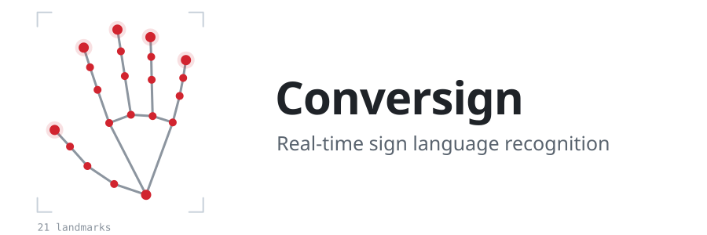
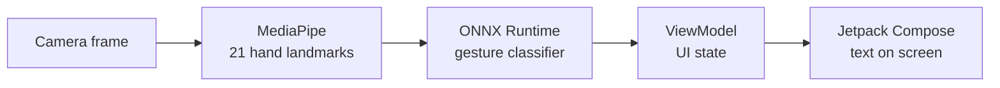

<picture>
  <source media="(prefers-color-scheme: dark)" srcset="assets/header-dark.svg">
  
</picture>

**3rd place worldwide, Huawei ICT Competition · Teknofest 2025 finalist**

Conversign is an Android app that translates sign language gestures into text in real time, using the phone's camera. Hand tracking and classification both run on the device, so recognition works without sending video to a server.

Available on Huawei AppGallery.

> This is a showcase repository. The source code is kept in a private repository; this page describes what the app does and how it is built.

<!--
## Screenshots

Add PNGs to docs/screenshots/ and uncomment this section.

  
  
  

-->

## What it does

- Reads the live camera feed and finds the hand in each frame.
- Extracts 21 hand landmarks with MediaPipe.
- Classifies the gesture with a model trained in PyTorch and exported to ONNX.
- Shows the recognized sign as text in the UI.

## How it works

The model is trained offline in PyTorch on collected gesture data, exported to ONNX, and bundled with the app. At runtime, ONNX Runtime runs inference on the landmark coordinates rather than raw pixels, which keeps the model small enough for a phone.

## Architecture

The app follows Clean Architecture with MVVM:

| Layer | Responsibility |
|---|---|
| Presentation | Jetpack Compose screens and ViewModels that expose UI state |
| Domain | Use cases for recognizing a gesture from a set of landmarks |
| Data | Camera input, MediaPipe hand landmark detection, ONNX Runtime inference |

The first version was written in Flutter. It was rewritten in native Kotlin and Jetpack Compose to fix compatibility issues on Huawei devices.

## Tech stack

Kotlin · Jetpack Compose · MVVM · Clean Architecture · MediaPipe · PyTorch · ONNX Runtime

## Running it

The source code is not public, so the app cannot be built from this repository. To try Conversign, install it from Huawei AppGallery.

## Contact

Ulaş Uçan · [LinkedIn](https://www.linkedin.com/in/ula%C5%9F-u%C3%A7an-36531626b) · [uls.ucn@gmail.com](mailto:uls.ucn@gmail.com)
